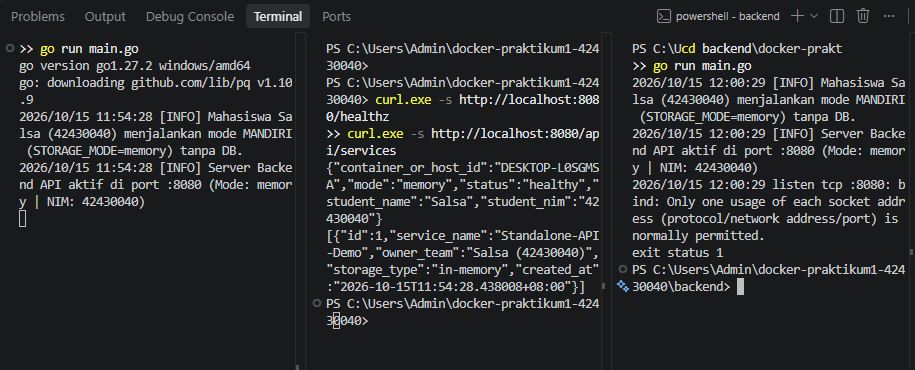
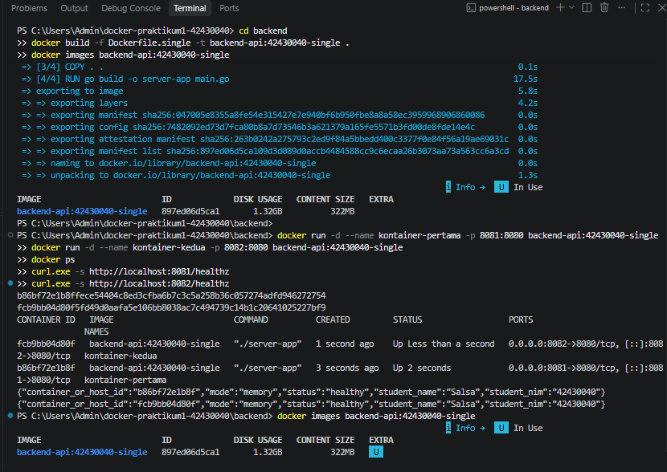
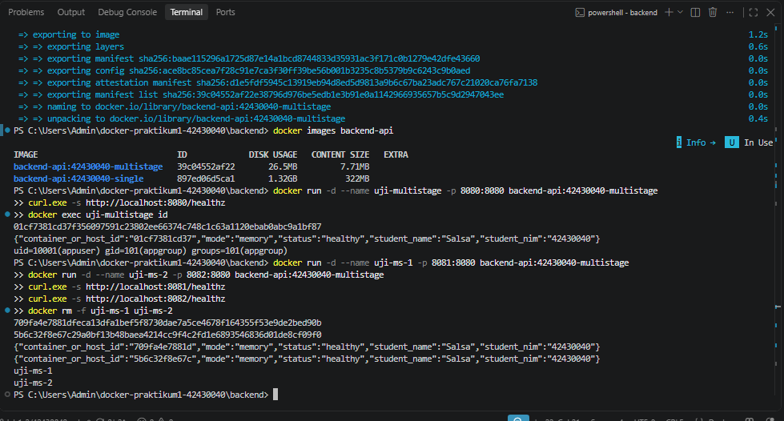
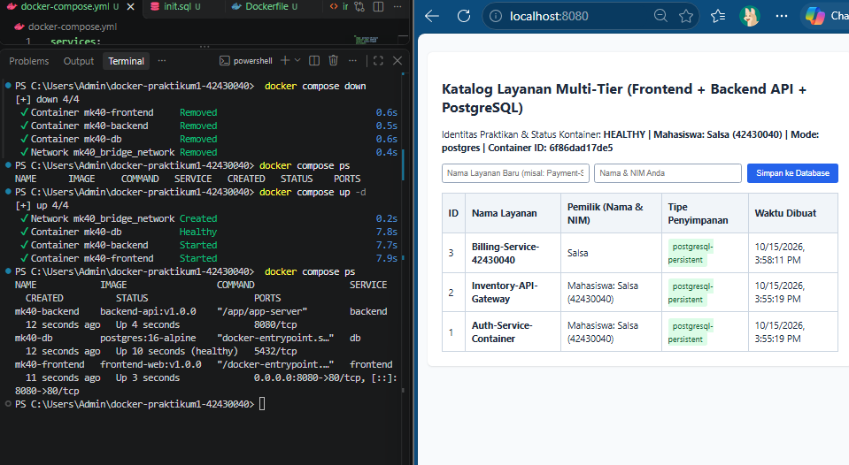
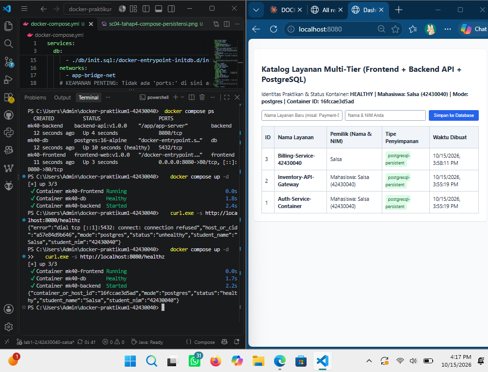
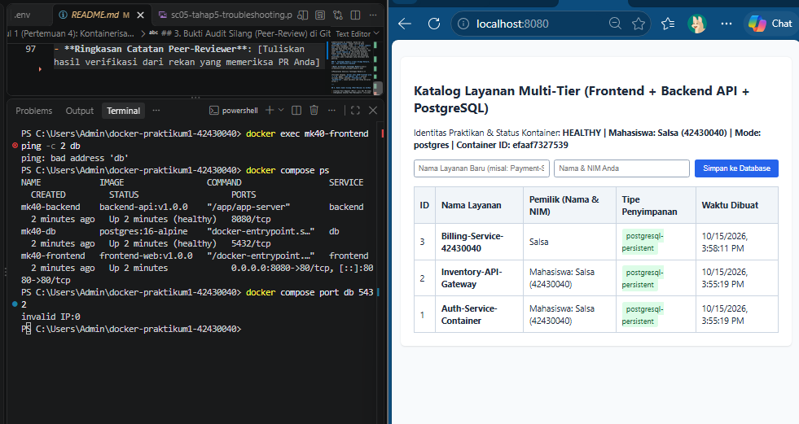

# Laporan Praktikum Modul 1 (Pertemuan 4): Kontainerisasi Docker & Orkestrasi Multi-Tier (Lab 1 & Lab 2)

- **Nama Mahasiswa**: Salsabila Nur Shafa
- **NIM**: 42430040
- **Kelas / Prodi**:Teknologi Informasi
- **Tautan Branch / Pull Request GitHub**: [Isi URL branch / PR Anda]
- **Nama Rekan Peer-Reviewer**: [Isi Nama & NIM rekan yang me-review PR Anda]

---

## 1. Tabel Komparasi Eksperimen Individu (Tahap 1 vs. Tahap 2 vs. Tahap 3)

| Parameter Pembanding | Tahap 1: Tanpa Docker (Native di Host OS) | Tahap 2: Docker Single-Stage (`Dockerfile.single`) | Tahap 3: Docker Multi-Stage (`Dockerfile` Lab 1) |
| :--- | :--- | :--- | :--- |
| **Kebutuhan Instalasi Go di Host** | Wajib instal Go SDK di laptop | [isi setelah Tahap 2] | [isi setelah Tahap 3] |
| **Ukuran Image (`docker images`)** | Tidak menghasilkan image | `... MB` | `... MB` (Target < 100 MB) |
| **Output `container_or_host_id` & NIM** | Hostname: `DESKTOP-L0SGMSA` \| NIM: `42430040` | Container ID: `...` \| NIM: `42430040` | Container ID: `...` \| NIM: `42430040` |
| **User Eksekusi Proses (`id`)** | User laptop saat ini | [isi setelah Tahap 2] | [isi setelah Tahap 3] |
| **Menjalankan 2 Instansi Sekaligus** | Gagal jika port sama (bind error) | [isi setelah Tahap 2] | [isi setelah Tahap 3] |

---

## 2. Bukti Screenshot & Penjelasan Analisis Setiap Tahapan

### A. Tahap 1 — Eksekusi Aplikasi Mandiri Tanpa Docker (Baseline)

**Penjelasan Analisis Tahap 1:**

Pada tahap ini aplikasi Backend Go dijalankan langsung di sistem operasi laptop (Windows) tanpa Docker, memakai `go run main.go`. Endpoint `/healthz` menampilkan NIM 42430040, nama Salsa, dan `container_or_host_id` berisi `DESKTOP-L0SGMSA`. Nilai itu adalah nama komputer (hostname) laptop saya, karena fungsi `os.Hostname()` membaca nama mesin tempat proses berjalan, dan tanpa container, mesin itu adalah laptop saya sendiri.

Ketika instansi kedua dijalankan di terminal lain, aplikasi langsung berhenti dengan pesan `bind: Only one usage of each socket address (protocol/network address/port) is normally permitted` (padanan di Windows untuk `bind: address already in use`) dan `exit status 1`. Penyebabnya, satu port (8080) pada satu host hanya bisa dipakai oleh satu proses. Karena kedua aplikasi berbagi jaringan dan port yang sama di host, instansi kedua bentrok dengan instansi pertama. Tanpa isolasi, aplikasi saling berebut sumber daya host. Selain itu, aplikasi hanya bisa berjalan jika Go SDK terpasang di laptop.

### B. Tahap 2 — Kontainer Tunggal dengan Single-Stage Dockerfile

**Penjelasan Analisis Tahap 2:**

[Tuliskan penjelasan Anda mengenai perubahan `container_or_host_id` menjadi ID Container, cara kerja pemetaan port `-p 8081:8080` dan `-p 8082:8080`, serta penyebab membengkaknya ukuran image single-stage hingga > 800 MB.]

### C. Tahap 3 (Lab 1 RPS) — Optimasi Dockerfile Multi-Stage Build (< 100 MB)

**Penjelasan Analisis Tahap 3:**

[Tuliskan persentase penurunan ukuran image dari Single-Stage ke Multi-Stage, penjelasan mekanisme `COPY --from=builder` dan Layer Caching `go.mod`, serta alasan keamanan menjalankan kontainer sebagai `appuser` (non-root).]

### D. Tahap 4 (Lab 2 RPS) — Orkestrasi Multi-Tier & Persistensi Data dengan Docker Compose

**Penjelasan Analisis Tahap 4:**

[Tuliskan penjelasan Anda mengenai alur komunikasi Reverse Proxy Frontend -> Backend -> Database PostgreSQL, serta bukti bahwa setelah `docker compose down && docker compose up -d`, Container ID berubah baru namun data ber-NIM Anda tetap tersimpan di Named Volume `pgdata`.]

### E. Tahap 5 — Skenario Troubleshooting & Analisis Error

**Penjelasan Analisis Tahap 5:**

[Tuliskan mengapa `DB_HOST=localhost` menyebabkan `connection refused` di dalam kontainer dan dampak penggunaan flag `-v` pada `docker compose down -v`.]

### F. Tantangan Mandiri — Dual Bridge Network, `.env`, dan Healthcheck Backend

**Penjelasan Analisis Tantangan Mandiri:**

[Tuliskan mengapa `docker exec mk40-frontend ping -c 2 db` gagal (`bad address 'db'`) setelah jaringan dibagi menjadi `frontend-net` dan `backend-net`, namun aplikasi web tetap berjalan normal.]

---

## 3. Bukti Audit Silang (Peer-Review) di GitHub

- **Tautan Pull Request (PR)**: [Isi URL PR Anda]
- **Ringkasan Catatan Peer-Reviewer**: [Tuliskan hasil verifikasi dari rekan yang memeriksa PR Anda]
